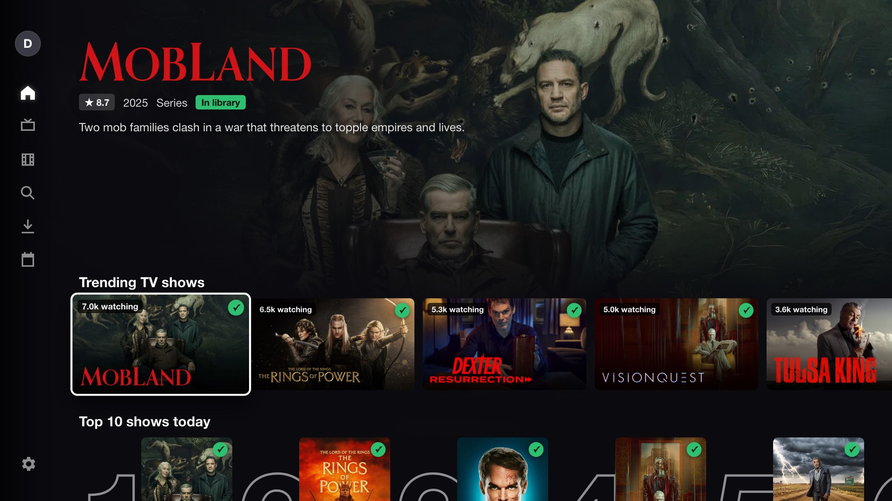
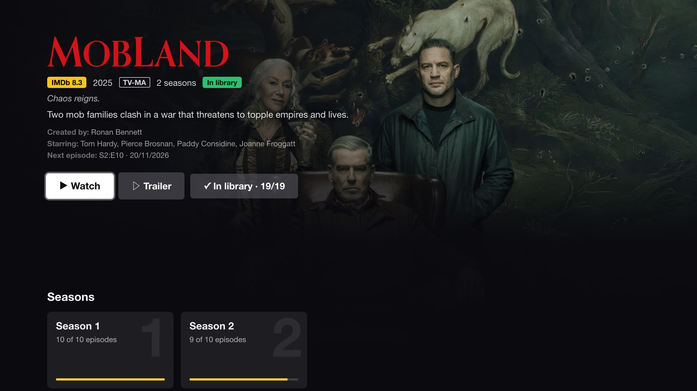
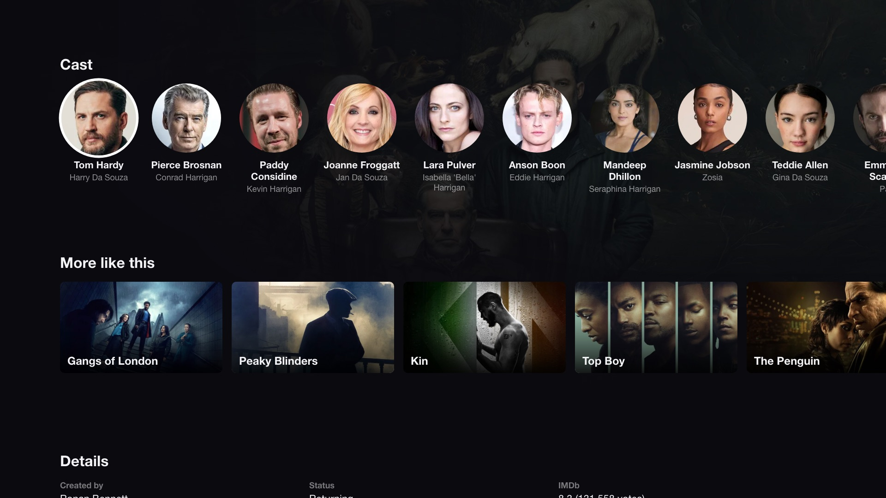
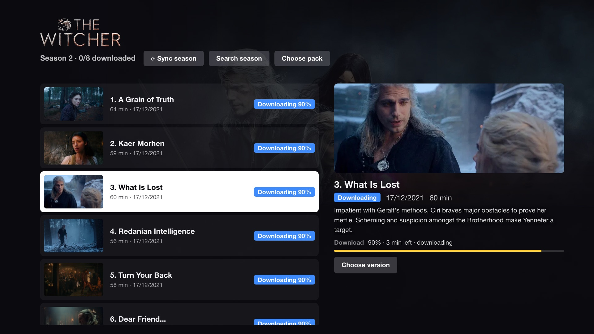
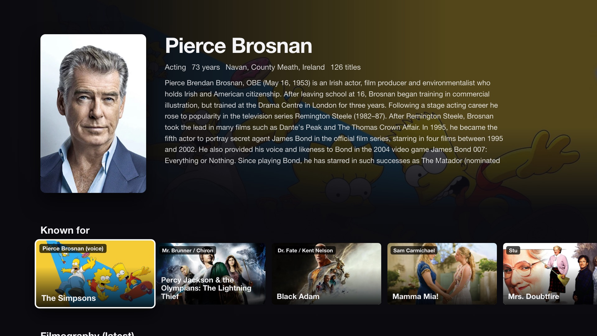
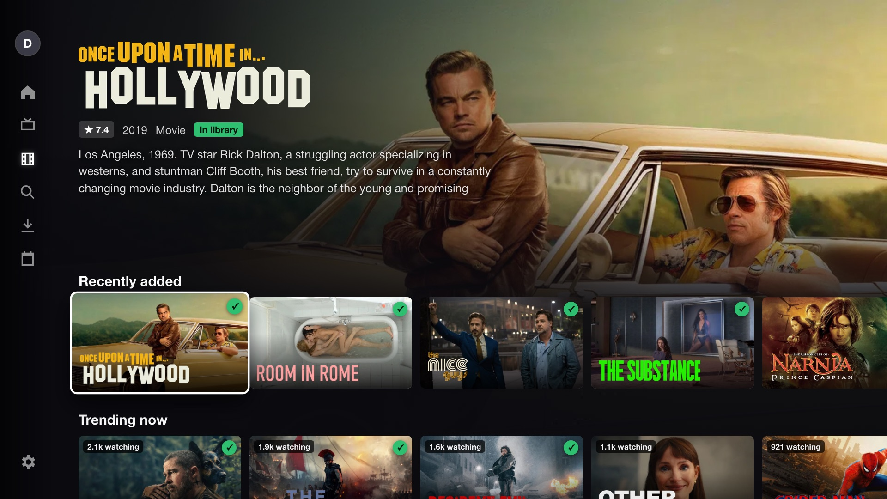
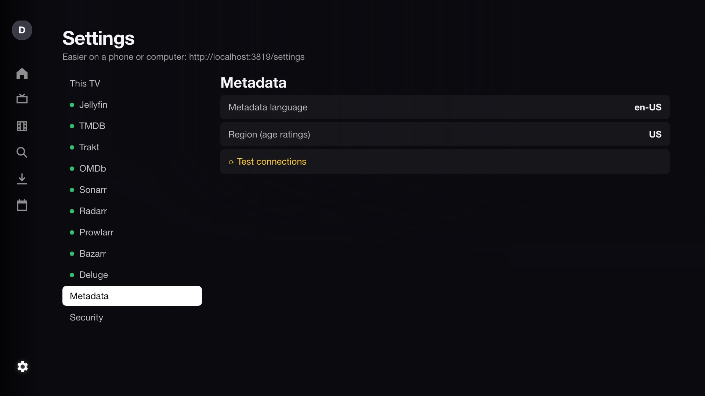
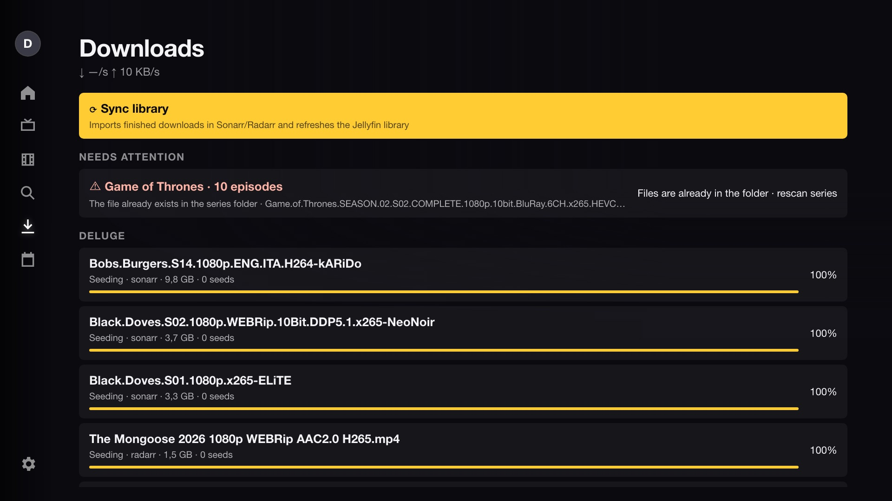
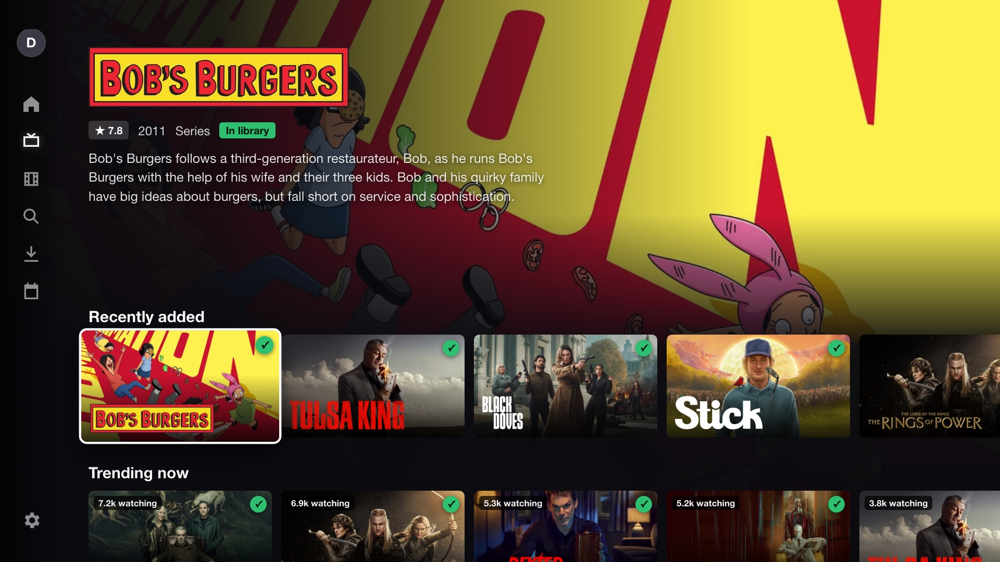
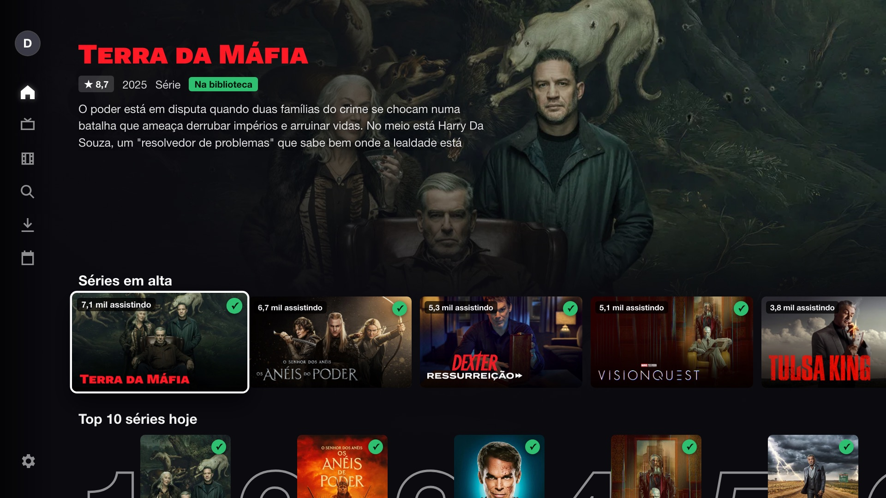

# Cinema

**A streaming-style TV app for Samsung Tizen TVs that turns your self-hosted media stack into one place to discover, download and watch.**

Cinema combines what's trending (Trakt, TMDB, IMDb ratings) with your own library (Jellyfin, Sonarr, Radarr, Prowlarr, Bazarr, Deluge). Browse with the remote, add a show in one press, pick a specific release, fix subtitles, and press play. Everything runs in your home network; the TV streams straight from your Jellyfin server.



| | |
|---|---|
|  |  |
|  |  |
|  |  |
|  |  |

<details><summary>Português (Brasil) interface</summary>


</details>

## Features

- **Discover**: trending, most-watched, most-anticipated and Top 10 rows from Trakt; genre rows from TMDB; title logos, backdrops and IMDb / Rotten Tomatoes / Metacritic ratings.
- **Library at a glance**: every card shows whether a title is in your library, downloading or monitored.
- **Title pages**: synopsis, age rating, seasons, cast with portraits (and a page for each person with their filmography), "More like this", trailers (YouTube) and details.
- **Add and download**: add a series or movie to Sonarr/Radarr with one press, or open the release list (all your Prowlarr indexers) and pick the exact version — per episode, per season pack or per movie.
- **Episodes**: per-episode status (downloaded, downloading, missing, not aired), file quality, audio and subtitle languages; search or replace any single episode.
- **Built-in player** (Samsung AVPlay, so MKV/HEVC/HDR play natively) streaming from Jellyfin:
  - direct play with automatic server-side transcoding fallback;
  - resume, watched state and "Continue watching" synced with Jellyfin;
  - audio and subtitle track selection;
  - **subtitle styles**: size, color, position, shadow, *black box* or *black band* (hides subtitles burned into the video);
  - search and download subtitles from Bazarr's providers, re-sync them with the audio (Bazarr/ffsubsync), or nudge the timing ±0.25 s;
  - skip intro / recap, next-episode countdown and seek thumbnails (when Jellyfin has media segments and trickplay).
- **Downloads**: live Deluge progress, the Sonarr/Radarr queue, a **Sync library** button (imports finished downloads and scans Jellyfin) and a *Needs attention* list with one-press fixes for stuck imports.
- **Coming up**: episodes and movies releasing in the next two weeks.
- **Profiles** from your Jellyfin users (Quick Connect or password), with your avatar in the menu.
- **Settings in the app** with live connection status for every service — or edit them from a phone or computer at `http://<server>:3817/settings`.
- **English and Português (Brasil)** interface; metadata language and region are configurable.

## How it works

```
 Samsung TV (Cinema app)  ──── browse, add, manage ────►  Cinema server (Node.js, this repo)
        │                                                   ├─ TMDB · Trakt · OMDb
        │                                                   └─ Sonarr · Radarr · Prowlarr · Bazarr · Deluge
        └──── stream video, profiles, progress ─────────►  Jellyfin
```

- **Cinema server** (`server/`): a small dependency-free Node.js service. It holds every API key, merges the data and serves a compact JSON API plus the web settings page. Keys never reach the TV.
- **TV app** (`tv/`): a Tizen web app (`.wgt`). It talks to the Cinema server for everything except video, which it streams directly from Jellyfin with the signed-in profile's token.

## Requirements

| Component | Required? | Used for |
|---|---|---|
| Samsung TV with Tizen in Developer Mode (developed and tested on **Tizen 5.5**, 2020 models) | ✅ | Running the app |
| **Tizen Studio CLI** on a computer | ✅ (install only) | Signing and installing the app |
| **Docker** or **Node.js 20+** | ✅ | Running the Cinema server |
| **Jellyfin** 10.9+ (Quick Connect enabled) | ✅ | Playback, profiles, progress |
| **TMDB** API read access token (free) | ✅ | Metadata, artwork, search |
| **Trakt** client ID (free) | Recommended | Trending / most watched rows |
| **OMDb** API key (free) | Optional | IMDb, Rotten Tomatoes, Metacritic ratings |
| **Sonarr** v4+ | Recommended | Series library, adding, episodes, releases |
| **Radarr** v5+ | Recommended | Movie library, adding, releases |
| **Prowlarr** | Optional | Indexers (used through Sonarr/Radarr) |
| **Bazarr** | Optional | Subtitle status, search, download and sync |
| **Deluge** (Web UI) | Optional | Live download progress |

Missing optional services simply hide the related features.

## Install

The short version:

```bash
git clone https://github.com/anarqz/tizen-cinema.git && cd tizen-cinema
docker compose up -d                       # Cinema server on port 3817
open http://localhost:3817/settings        # fill in your services and keys
tools/install-tv.sh <tv-ip>                # sign + install the TV app (Tizen CLI)
```

Then open **Cinema** on the TV, enter the server address (e.g. `http://192.168.1.10:3817`) and pick your profile.

The step-by-step guide — Docker / TrueNAS / plain Node, Developer Mode, certificates and troubleshooting — is in **[docs/INSTALL.md](docs/INSTALL.md)**.

## Configuration

All settings live in `data/config.json` on the server and are edited from the app (**⚙ Settings**) or the web page at `/settings`. Environment variables (see [`.env.example`](.env.example)) are optional initial values; values saved in the app take precedence. Set `SETTINGS_PIN` (or the PIN in *Security*) to require a PIN before settings can be changed.

| Setting | Env variable | Notes |
|---|---|---|
| Jellyfin URL | `JELLYFIN_URL` | Address the **TV** uses to reach Jellyfin |
| TMDB token | `TMDB_TOKEN` | "API Read Access Token" (v4) |
| Trakt client ID | `TRAKT_CLIENT_ID` | Create an app at trakt.tv/oauth/applications |
| OMDb key | `OMDB_API_KEY` | omdbapi.com (activate it from the e-mail) |
| Sonarr / Radarr | `SONARR_URL`, `SONARR_API_KEY`, `SONARR_QUALITY_PROFILE` (same for `RADARR_…`) | Quality profile used when adding; empty = first 1080p profile |
| Prowlarr | `PROWLARR_URL`, `PROWLARR_API_KEY` | Status only; searches go through Sonarr/Radarr |
| Bazarr | `BAZARR_URL`, `BAZARR_API_KEY` | Settings → General → Security → API Key |
| Deluge | `DELUGE_URL`, `DELUGE_PASSWORD` | Web UI password |
| Metadata language / region | `METADATA_LANGUAGE`, `REGION` | e.g. `pt-BR` / `BR` for Brazilian titles and age ratings |

The TV app's own interface language (English / Português) is chosen in **Settings → This TV**.

## Security notes

- The Cinema server is meant for your **home network**. It has no user accounts of its own; anyone who can reach it can browse and trigger downloads. Don't expose it to the internet. Use the settings PIN to protect configuration changes.
- API keys are stored on the server only (`data/config.json`, mode 600) and are never returned in full by the API.
- Jellyfin access tokens are stored on the TV only, one per profile.

## Development

- Server: `node server/index.js` (no dependencies). `DATA_DIR`, `PORT` and the variables above apply.
- TV app: plain ES2017 for the TV's Chromium 63 engine — no build step. Open `tv/index.html?api=http://localhost:3817` in a desktop browser to preview (video playback needs the TV).
- UI strings live in `tv/i18n.js` (`en-US`, `pt-BR`); the server sends keys and codes, never translated text.

## Disclaimer

Cinema is a client for software you run yourself. It does not host, index or provide any content. You are responsible for complying with the laws of your country and the terms of the services you connect.

## License

[MIT](LICENSE)
